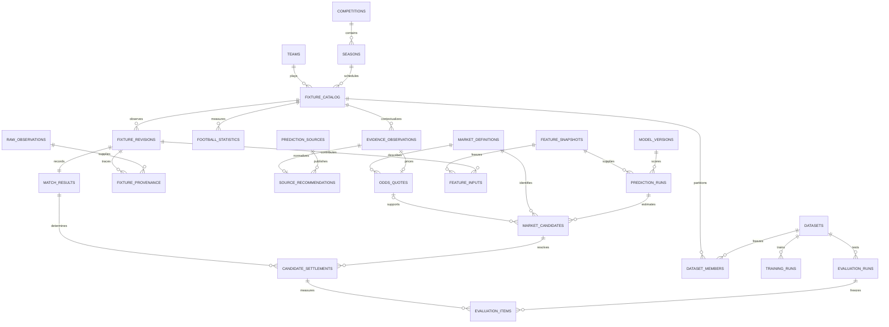

# Futuro database and learning design

Current schema version: 4. The version 2 relationships below remain intact; version 3 adds training records described in TRAINING.md, and version 4 adds durable scheduled workflows described in AUTOMATION.md. The database keeps football observations, prediction decisions, and experiment results as separate histories. A later correction adds a record rather than rewriting the evidence behind an earlier forecast.

Application storage uses PostgreSQL when `DATABASE_URL` is set, or local SQLite otherwise. [PostgreSQL migrations](POSTGRES.md) maintain the equivalent 45 data tables and history protections in Neon's `futuro` schema, with insertion-order identities and bulk ingestion. PostgreSQL migration numbering is separate from SQLite's schema version. Existing local history is not automatically uploaded. No paid database service is required.

## How the records connect



## What we retain

| Area | Tables | Purpose |
| --- | --- | --- |
| Football identity | `competitions`, `seasons`, `teams`, `fixture_catalog` | Queryable league/season/team identities and a pointer to each fixture's current revision |
| Original observations | `raw_observations`, `fixture_revisions`, `fixture_provenance` | Original payloads, capture times, and exact new observation lineage |
| Results | `match_results` | Regulation scores and fixture status at every recorded revision, including corrections |
| General statistics | `football_statistics` | Team goals, corners, shots, shots on target, xG and possession, with period, provider, observation time and source reference |
| News/context | `evidence_observations` | Dated injuries, context notes, quotes and external picks; structured payload retained alongside indexed kind/time fields |
| Prediction websites | `prediction_sources`, `source_recommendations` | Original first/best recommendation, article URL, normalized market where possible, individual source track record |
| Markets and prices | `market_definitions`, `odds_quotes` | Exact event semantics, period, line, bookmaker, decimal odds and manually verified rule reference |
| Model identity | `model_versions` | Human label, scoring-artifact hash, immutable configuration and provenance status |
| Model inputs | `feature_snapshots`, `feature_inputs` | Exact computed features, cutoff, version, reconstruction flag and input revision IDs |
| Forecast decisions | `prediction_runs`, `prediction_evidence`, `market_candidates` | Probability for each market, quote linkage, preference pass/fail reasons, source support, abstentions and evidence actually available at cutoff |
| Outcomes | `candidate_settlements` | Outcome, specific result revision, rule version and hypothetical stake/profit when a verified quote exists |
| Reusable experiments | `datasets`, `dataset_members` | Frozen fixture membership, result revisions and chronological train/validation/test splits |
| Training provenance | `training_runs`, `training_examples`, `training_events` | Actual local trainer jobs, exact eligible/blocked snapshots, configuration/code hash and lifecycle |
| Trained artifacts | `model_artifacts`, `training_reports`, `training_evaluations` | Immutable artifact JSON/digest/file reference, validation trials, and linked baseline/challenger test comparison |
| Frozen evaluation | `evaluation_runs`, `evaluation_predictions`, `evaluation_items` | Stored metric version/results and exact predictions/settlements used in a comparison |
| Daily operations | `automation_runs`, `automation_tasks`, `automation_locks`, `provider_cooldowns` | Frozen run policy, durable task/retry state, worker lease and shared throttling |
| Live tracking audit | `automation_prediction_links`, `automation_events`, `automation_reports` | Atomic prediction deduplication, lifecycle history and immutable live analytics snapshots |

Existing `fixtures`, `evidence`, `predictions` and `settlements` JSON records remain intact for compatibility and audit. Their relational projections are written in the same transaction. A projection failure rolls back the original write too. They are not separately editable competing sources of truth.

Current team IDs are scoped to a competition and canonical name, matching the initial supported domestic leagues. Cross-league club identities and provider-specific player registries will require explicit mappings; the schema does not pretend similarly named teams/players are automatically identical.

## Time, correctness and revisions

- **Kickoff/event time** describes when football happened; **observation time** describes when Futuro captured the record. A publication date is separate from capture time for evidence.
- A prediction stores its cutoff and feature snapshot. Evidence must belong to that fixture and have both publication and capture times at or before cutoff.
- Newly created snapshots reference exact input fixture revisions. Old predictions did not capture this lineage, so migration leaves it unknown rather than guessing.
- A corrected score creates another `match_results` record and settlement revision. Current analytics uses only settlements matching the current fixture revision. A result awaiting re-settlement is excluded from current metrics.
- A frozen evaluation continues to use its original settlement/result IDs. Evaluating a dataset whose test results changed requires a new dataset snapshot; earlier evaluation reports remain reproducible.
- Prediction, evidence, result, statistical and evaluation histories have database triggers preventing UPDATE/DELETE. Current fixture pointers, response cache and operational request counters may change. Training job status may advance.
- Bookmaker prices remain attached to their exact market. Foreign keys prevent using a quote for another market. Settlement integrity checks reject results from another fixture or incomplete scores.

Date-only history excludes same-day results. Retrospective reconstructions remain labeled as such: they cannot prove the availability of historical injuries, news or prices.

## Metrics that guide improvement

For a binary market, let `p` be the predicted probability and `y` the actual outcome (0 or 1).

| Metric | Meaning |
| --- | --- |
| Hit rate | Mean `y`; useful alongside odds, market and sample count |
| Brier score | Mean `(y-p)^2`; evaluates probability accuracy, lower is better |
| Log loss | Mean negative log probability assigned to the actual outcome; exposes overconfident mistakes |
| Mean residual | Mean `y-p`; positive means outcomes happened more often than predicted in that sample |
| Calibration bins | Actual frequency versus average predicted probability within each probability band |
| Expected calibration error | Count-weighted absolute bin difference; depends on binning and sample size |
| Outcome sample variance | Empirical variation in 0/1 outcomes, using denominator `n-1` |
| Residual sample variance | Empirical variation in prediction errors `y-p`, using denominator `n-1` |
| Mean predicted outcome variance | Mean `p(1-p)`; the uncertainty implied by the model's own probabilities |
| Return sample variance/std. deviation | Variation of hypothetical per-unit profit, available only for captured, verified prices |
| Hypothetical ROI | Total hypothetical profit / stake for the evaluated priced candidates |
| Hypothetical drawdown | Peak-to-trough cumulative hypothetical profit, with markets aggregated by fixture and fixtures ordered by kickoff then fixture ID; illustrative rather than an actual settlement-time bankroll trace |

Empty metrics are `null`; sample variance is also `null` below two observations. Log loss clips impossible realized-event probabilities at `1e-15` and reports how many were clipped. Closing-line value remains unavailable until matching closing quotes are collected.

Variance is not a calibrated confidence interval. Repeated markets on one game are correlated, and games can share teams and conditions. The reports expose both candidate and distinct fixture counts. Grouped metrics and large errors suggest hypotheses; they do not establish causal injury, sentiment, or source effects.

`GET /analytics` includes breakdowns by market, league, model, month, odds band, corroboration, and whether injury evidence was recorded. Missing injury evidence does not mean players were fit. `largestErrors` links high-loss forecasts back to their stored features/evidence for review.

## The improvement loop

1. Collect results/statistics and preserve data quality/missingness. Capture future odds/news before predictions rather than reconstructing them after outcomes.
2. Freeze an earlier **training** period, later **validation** period for choosing features/weights, and a still-later **test** period.
3. Train a candidate model on training data only. Record its dataset, configuration, code hash and artifact in `training_runs`; keep the existing model as the baseline.
4. Use validation data for tuning. Freeze the chosen model before examining its final test results.
5. Generate timestamped predictions. Store all candidates, preference failures and abstentions to expose coverage and selection bias.
6. Freeze evaluations for baseline and challenger on the same test dataset. Compare matched fixture/market pairs and monitor chronological/monthly behavior.
7. Promote changes only after evidence supports an improvement; continue prospective monitoring. Keep the previous version and experiment records.

The local trainer now performs bounded goal-rate fitting and a nine-configuration validation search, followed by a held-out baseline comparison. Significance testing, automatic promotion and retraining schedules remain future work. The fixed-form baseline stays available. Adding data alone does not run the trainer or demonstrate improvement. See TRAINING.md.

All markets for a fixture belong to one dataset split. Dataset validation rejects duplicates across splits and requires training to complete before validation starts, and validation before test. The trainer freezes feature lineage, verifies target revisions, and excludes test labels from tuning. Repeated experimentation against one test set eventually requires another untouched holdout.

## API and example

| Route | Purpose |
| --- | --- |
| `GET /models` | Discover registered model IDs, artifact/configuration and legacy provenance flags |
| `GET /analytics?mode=historical&market=over_1_5&selection=all` | Full accuracy, calibration, variance and diagnostic report |
| `GET /analytics?mode=historical&modelId=ID&selection=preference_passed` | Assess a specific model and preference-filtered cohort |
| `GET /sources/performance` | Latest captured pre-kickoff recommendation per source/fixture; no hindsight entries or demo games |
| `POST /statistics` | Append a sourced final-match statistic; never silently changes the existing model |
| `GET /fixtures/:id/statistics` | All recorded statistical observations, including revisions |
| `POST /datasets`, `GET /datasets`, `GET /datasets/:id` | Create/read immutable chronological membership snapshots |
| `POST /evaluations`, `GET /evaluations` | Freeze/read test-set metrics and the records behind them |
| `POST /evaluations/compare` | Matched-candidate Brier comparison on the same frozen dataset |

Dataset request (IDs must identify completed fixtures in chronological periods):

```json
{
  "name": "First chronological benchmark",
  "mode": "historical",
  "description": "Freeze before tuning the next model",
  "train": ["EARLIER_FIXTURE_ID"],
  "validation": ["LATER_FIXTURE_ID"],
  "test": ["LATEST_FIXTURE_ID"]
}
```

After creating predictions and running settlement, freeze an evaluation:

```json
{"name":"Baseline holdout","datasetId":"DATASET_ID","modelId":"MODEL_ID"}
```

The operation does not train anything. It stores the latest settled forecasts for that model on the frozen test fixtures, reports scoring coverage, and identifies the precise result revisions. Missing/unscored fixtures remain visible in the test denominator.

Compare two evaluations:

```json
{"leftId":"BASELINE_EVALUATION_ID","rightId":"CHALLENGER_EVALUATION_ID"}
```

A negative `rightMinusLeftBrier` favors the challenger on the matched candidates. This is a descriptive comparison, not proof of statistical significance or profitability.

Final-match statistic request:

```json
{"fixtureId":"ID","side":"home","metric":"corners","period":"regulation","value":7,"sourceReference":"https://example.com/match-report"}
```

Corners can be stored now; a corner forecasting model still requires enough reliable data and independent validation.

## Migration and operations

`Store` applies migrations automatically on first open, through current version 4. Existing populated databases get a SQLite-consistent backup beside the database named `*.pre-vN-TIMESTAMP.sqlite`, before each migration transaction. All projections/backfills for a migration commit together; a failed migration rolls back. Original JSON histories stay intact.

```powershell
npm run db:inspect
```

This opens/migrates the configured database and prints schema version, row counts and foreign-key violations. No API key or Python service is required. Backups and databases remain under ignored local data storage.

Legacy models are marked `legacy_unverified`; missing old configuration/code digests, feature-input lineage and settlement-recording times are not invented. New Python responses report a scoring-artifact SHA-256 and explicit baseline configuration. This is captured provenance, not independent verification of a remote service's code.

SQLite is appropriate for this local milestone. A PostgreSQL migration, worker concurrency controls and external artifact storage can follow when ingestion/model jobs require them, using these same logical relationships.
